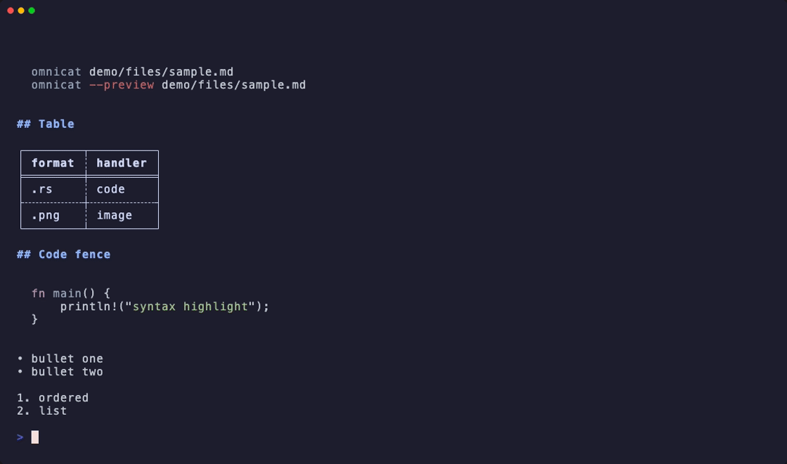

[](https://github.com/s00d/omnicat)
[](https://github.com/s00d/omnicat/actions/workflows/ci.yml)
[](LICENSE)
[](https://www.rust-lang.org/)
[](https://www.donationalerts.com/r/s00d88)

<p align="center">

</p>

# omnicat

**Preview almost any file in your terminal — or in a GUI window.**  
**Also: inspect artifacts (info, schema, find, hash, …) — no live servers, no subcommands.**

omnicat is a smarter replacement for `cat` when you are working interactively. Point it at a file or folder and get a readable preview: Markdown with formatting, syntax-highlighted code, spreadsheet tables, PDF text, ebook chapters, archive trees, images, SQL dumps, logs, and more.

When you pipe output to another command or redirect to a file, omnicat behaves exactly like plain `cat` — raw bytes, no surprises.

**Make `cat` smart — transparently.** Keep typing `cat` as you always have. With the optional shell shim (below), a single file in an interactive terminal renders as a preview; pipes, redirects, multiple files, and flags stay plain `cat`, byte for byte. You can also call `omnicat` directly — both names do the same thing once the shim is enabled.

## Install

```bash
cargo install omnicat
```

Requires Rust **1.92+** and `~/.cargo/bin` on your `PATH`.

## What's new

- **Unified search** — one predicate engine powers `--find` and dump `WHERE` (shorthand `level:error`, SQL fragments, substring). Full `SELECT` stays on `-q`.
- **SQL dumps** — structured overview (CREATE + sample INSERT rows), `--schema` / `--table NAME`, and streaming `-q` without importing into SQLite.
- **Logs** — JSON lines and logfmt `key=value` lines are searchable with the same predicates as JSONL / dumps.
- **No subcommands** — preview + inspect flags only (`--status`, `--init`, `--native` are top-level flags).

## Demo

Terminal previews (Markdown, syntax-highlighted code, CSV, directory tree, `--status`) — recorded with [VHS](https://github.com/charmbracelet/vhs).

<p align="center">

</p>

<em>Re-record: <code>cargo build --release && vhs demo/omnicat-demo.tape</code> (see <a href="demo/README.md">demo/README.md</a>). Commands are typed hidden so the GIF shows results, not keystrokes.</em>

## Who is this for?

- **Developers** who live in the terminal and want one command to inspect any artifact in a repo
- **Data and ops folks** who need quick looks at JSON, CSV, Parquet, SQLite, logs, SQL dumps, and mongodump trees
- **Anyone on macOS or Linux** who is tired of remembering which tool opens which format

No server, no account, no external renderers required for built-in formats. Optional tools (glow, bat, imgcat, …) can be wired in through config if you want them.

## Quick start

```bash
cat README.md                 # same as omnicat README.md (with shim enabled)
omnicat README.md             # rendered Markdown
cat src/main.rs               # syntax-highlighted source
omnicat report.xlsx           # spreadsheet preview
cat archive.zip               # archive tree
omnicat notes.epub --paginate # ebook text, page 1 + footer
omnicat notes.epub --page 3   # ebook text, page 3 + footer
cat project/                  # directory tree

omnicat --preview diagram.png # GUI window (when a display is available)
cat file.md | grep keyword    # pipe → plain cat (raw bytes)
cat a.txt b.txt               # multiple files → plain cat
cat -n file.md                # flags → plain cat

# Artifact inspector (works when piped; use --json for scripts)
omnicat --info image.png
omnicat --schema users.csv
omnicat --find TODO archive.zip
omnicat db.sqlite -q 'SELECT * FROM users LIMIT 5'
omnicat --stats .
omnicat --hash file.iso
omnicat --duplicates ~/Downloads
omnicat --diff a.json b.json
omnicat backup.zip/config.yaml
omnicat report.pdf --text

# SQL dumps & search (see “Search & query” below)
omnicat backup.sql
omnicat backup.sql --schema
omnicat backup.sql --table users
omnicat backup.sql -q "SELECT * FROM users WHERE status = 'ok' LIMIT 5"
omnicat backup.sql -f "status = 'ok' AND id > 1"
omnicat app.jsonl -f 'level:error'
omnicat app.log -f "service = 'api' AND level = 'error'"

omnicat --capabilities
omnicat --status
```

## Inspect

omnicat can inspect artifacts without opening a file manager:

| Flag | Purpose |
|------|---------|
| `--info` | Type-specific metadata |
| `--type` / `--mime` | Type label / MIME |
| `--schema` | Columns / tables for structured data; on **SQL dumps** also a structure-only preview |
| `--table NAME` | SQL dump: one table (structure + sample rows) |
| `--stats` | Counts for files, dirs, archives, text, images, media |
| `--find <q>` / `-f` | Field-aware search (see below) or substring |
| `--capabilities` | Supported inspect features per handler |
| `--query <expr>` / `-q` | Full `SELECT` on SQLite / SQL dumps; jq-lite / predicates on JSON / CSV / Parquet |
| `--hash` | MD5/SHA1/SHA256/SHA512/BLAKE3 (recursive for directories) |
| `--duplicates` | Duplicate files under a directory |
| `--diff a b` | Structural / rendered diff (JSON/CSV/Markdown; SQLite tables + schema) |
| `--watch` / `--follow` | Live re-render / tail -f (JSON logs + stack traces) |
| `--text` / `--raw` | Extract text or dump bytes |
| `--encoding` | Detect encoding / BOM / line endings |
| `--json` | Machine-readable output for any inspect mode |
| `--all` | Disable byte and row limits |
| `--progress` | Throttled progress on **stderr** for long `--find` / dump `-q` / `--hash` / `--duplicates` (TTY only; ~200ms or ≥1 MiB between updates) |
| `archive.zip/path` | Virtual path into zip/tar/tar.gz/tar.zst without unzip |

JSONL logs get a first-class table layout when fields look like logs (`TIME` / `LEVEL` / `SERVICE` / `MESSAGE`). `--follow` pretty-prints JSON log lines the same way and keeps stack-trace continuations with the matching level block.

Image `--info` includes dimensions, color, and bit depth. Markdown `--diff` compares terminal-rendered text (not raw source), so equivalent markup with the same visible content is identical.

Inspector commands always write to stdout (including pipes). Without inspect flags, pipe/multi-file behavior stays plain `cat`.

## Search & query

One idea underpins search: **parse the pattern into a predicate AST**, turn each candidate row/line into a **field map**, then evaluate. Preview stays separate; this section is about `-f` / `--find` and `-q` / `--query`.

```text
  --find PATTERN ──► shorthand | SQL WHERE | substring ──► SearchPred (+ optional substring)
  -q SELECT …    ──► projection / FROM / WHERE / ORDER / LIMIT   (WHERE uses the same SearchPred)

  Candidate “row”
    • JSONL / JSON object     → fields from keys
    • .log / text line        → JSON object, or logfmt key=value pairs
    • SQL dump INSERT tuple   → columns from CREATE / INSERT
    • SQLite table row        → column names
    • plain text (no fields)  → substring only
```

### `--find` vs `-q`

| | `--find` / `-f` | `--query` / `-q` |
|--|-----------------|------------------|
| **Job** | Filter / locate matching lines or rows | Project and page results (tables) |
| **SQL dumps** | Match INSERT rows; print `table row N: …` | Stream `SELECT` (no SQLite import) |
| **SQLite** | Scan tables for matching rows | Full SQL via rusqlite |
| **JSONL / logs** | Match lines by fields or substring | jq-lite / predicates where supported |
| **Full `SELECT`** | **Rejected** — use `-q` | Required shape for dump/SQLite SQL |

### Pattern syntax (`--find`)

Three forms (detected automatically):

1. **Shorthand** (legacy, still the default for logs):
   - `level:error` → field `level` equals `error`
   - `status==ok` / `id>1` → comparison operators
2. **SQL `WHERE` fragment** (no `SELECT` / `FROM`):
   - `status = 'ok' AND id > 1`
   - `level = 'error' OR message LIKE '%timeout%'`
   - `service IN ('api','db')`, `trace_id IS NOT NULL`
3. **Bare substring** — if it is not shorthand and not SQL-like: case-insensitive contains on the whole line (or cell values for dumps/SQLite).

Supported predicate pieces (shared with dump `WHERE`): `AND` / `OR` / `NOT`, `=` `!=` `<>` `<` `<=` `>` `>=`, `LIKE`, `IN (…)`, `IS NULL` / `IS NOT NULL`. **No `JOIN`.**

If the pattern starts with `SELECT`, omnicat errors and tells you to use `-q`.

### How a line becomes fields

| Input line | Fields extracted |
|------------|------------------|
| `{"level":"error","service":"db","message":"…"}` | JSON object keys |
| `ts=… level=ERROR service=worker msg="job failed"` | logfmt `key=value` (quoted values OK; leading timestamps skipped) |
| `2026-08-06 ERROR disk full` | none → only substring works |
| dump `INSERT INTO users VALUES (1,'a@…','ok')` | `id`, `email`, `status` from CREATE/INSERT |

Extras for logs: `level` / `severity` values are matched case-insensitively; `msg` and `message` are aliased.

### Examples — SQL dump

Fixtures live under `demo/db/`. Preview needs a TTY for the formatted overview; inspect flags (`-f`, `-q`) always print to stdout.

```bash
# Overview: CREATE structure + sample INSERT data per table
omnicat demo/db/sample.sql

# Structure only / one table
omnicat demo/db/sample.sql --schema
omnicat demo/db/sample.sql --table users

# -q: single-table SELECT, streamed from the dump (no import)
omnicat demo/db/sample.sql -q "SELECT * FROM users LIMIT 5"
omnicat demo/db/sample.sql -q "SELECT email, status FROM users WHERE status = 'ok'"
omnicat demo/db/sample.sql -q "SELECT * FROM users WHERE status = 'ok' AND id > 1 ORDER BY id DESC LIMIT 10"
omnicat demo/db/sample.sql -q "SELECT COUNT(*) FROM orders WHERE status = 'failed'"

# -f: same WHERE language, but “find hits” instead of a result table
omnicat demo/db/sample.sql -f "status:ok"
omnicat demo/db/sample.sql -f "status = 'ok' AND id > 1"
omnicat demo/db/sample.sql -f "email LIKE '%example.com'"
omnicat demo/db/sample.sql -q "SELECT * FROM users WHERE status = 'ok'" --progress
```

Logic for dumps:

1. Parse `-q` into select-list / table / `WHERE` / `ORDER BY`+`LIMIT` / `OFFSET` / `COUNT`.
2. Stream statements; remember `CREATE TABLE` column lists; on matching `INSERT`, build a field map per tuple.
3. Evaluate `WHERE` with `SearchPred`; project columns; optional top-k sort when `ORDER BY` + `LIMIT` are present.

`--find` skips projection and prints matching rows as text hits.

### Examples — SQLite

```bash
omnicat demo/files/sample.sqlite
omnicat demo/files/sample.sqlite --schema
omnicat demo/files/sample.sqlite -q 'SELECT * FROM users LIMIT 5'
omnicat demo/files/sample.sqlite -f 'status:ok'
```

Here `-q` is real SQL (rusqlite). `--find` walks tables, builds a field map per row, and applies the same predicate AST.

### Examples — JSONL & logs

```bash
# JSONL / NDJSON (Data handler)
omnicat demo/files/sample.jsonl -f 'level:error'
omnicat app.jsonl -f "level = 'error' AND service = 'api'"
omnicat app.jsonl -f timeout                    # substring in message / raw line

# JSON lines or logfmt in .log (Fallback handler — same predicates)
omnicat demo/log/json.log -f 'level:error'
omnicat demo/log/json.log -f "service = 'db' AND level = 'error'"
omnicat demo/log/logfmt.log -f 'level:error'
omnicat demo/log/logfmt.log -f "job_id > 42"
omnicat demo/log/tracing.log -f 'level:error'   # level=ERROR still matches
omnicat demo/log/text.log -f 'disk full'        # no fields → substring
```

### What `-q` supports on SQL dumps

| Feature | Supported |
|---------|-----------|
| `SELECT *` / column list | yes |
| `FROM` one table | yes |
| `WHERE` (AND/OR/cmp/LIKE/IN/IS NULL) | yes |
| `ORDER BY` + `LIMIT` (top-k) | yes |
| `OFFSET` | yes |
| `COUNT(*)` | yes |
| `JOIN`, subqueries, multi-table | no |

Compressed dumps (`.sql.gz`, `.sql.zst`, …) use the same path as plain `.sql`.

## SQL dumps & SQLite (preview)

- `omnicat backup.sql` / `.sql.gz` → dump **overview** (tables, CREATE structure, sample INSERT rows). Needs a TTY for the rendered layout; under a pipe you get raw bytes like `cat`.
- `--schema` → structure only; `--table NAME` → one table with data samples.
- `omnicat app.sqlite` → schema + sample rows; use `-q` for ad-hoc SQL.

There are **no** `log` / `db` subcommands — point omnicat at the file and use inspect flags.

## Make `cat` smart (opt-in)

The installed command is **`omnicat`**. It does not replace `/bin/cat` unless you ask it to.

To route interactive `cat` through omnicat, add **one line** to your shell config. After that, `cat` and `omnicat` are interchangeable in everyday use; the examples above work with either name.

### Setup

**zsh** — add to `~/.zshrc`:

```zsh
eval "$(omnicat init zsh)"
```

**bash** — add to `~/.bashrc` (or `~/.bash_profile` on macOS):

```bash
eval "$(omnicat init bash)"
```

**PowerShell**:

```powershell
omnicat init powershell | Invoke-Expression
```

Reload the shell (`source ~/.zshrc`, etc.). The shim defines a shell function named `cat` that forwards to `omnicat` when it is on your `PATH`, and falls back to the real `cat` otherwise.

What `omnicat init zsh` emits (simplified):

```bash
cat() { if command -v omnicat >/dev/null 2>&1; then command omnicat "$@"; else command cat "$@"; fi; }
```

Only your **interactive** shell runs this wrapper. Scripts, `cron`, and non-interactive `sh script.sh` keep using the system `cat`.

### Why it is safe

Preview mode runs only when **all** of these are true:

- stdout is a terminal (not a pipe or a file redirect);
- exactly **one** argument was given;
- that argument is a readable **file or directory**, not a flag (`-n`, `--help`, etc.).

Anything else delegates to the real `cat` with your arguments unchanged:

| Situation | What happens |
|-----------|----------------|
| `cat file.md` in a TTY | Rendered preview |
| `cat file.md \| grep x` | Raw bytes (stdout is not a TTY) |
| `cat a.txt b.txt` | Plain `cat` (multiple files) |
| `cat -n file.md` | Plain `cat` (flag present) |
| `cat < file.md` | Plain `cat` (no filename argument) |

### Force plain `cat`

Pass **`-native`** (or `--native`) as the **first** argument to skip rendering even in an interactive terminal:

```bash
cat -native README.md       # raw file, no Markdown rendering
omnicat -native -n file.md  # remaining args go to system cat
```

`-native` is an omnicat directive and must come first.

### Undo

Remove the `eval "$(omnicat init …)"` line from your shell config and reload. Optionally delete `~/.config/omnicat/`.

## Everyday commands

| What you want | Command |
|---------------|---------|
| Terminal preview | `cat <file>` or `omnicat <file>` (with shim) |
| Folder tree | `cat <directory>/` |
| GUI preview | `omnicat --preview <path>` |
| GUI only (no terminal output) | `omnicat --preview-only <path>` |
| Force plain `cat` | `cat -native <file> …` or `omnicat -native …` |
| Page long output (page 1) | `omnicat --paginate <file>` |
| Open a specific page | `omnicat --page N <file>` |
| Find in file / dump / log | `omnicat <file> -f 'level:error'` |
| Query SQLite / SQL dump | `omnicat <file> -q 'SELECT …'` |
| Progress on long scans | `omnicat <file> -f … --progress` |
| Check what works on your system | `cat -status` or `omnicat -status` |
| Help | `omnicat --help` |

## Terminal paging

Long output can be split into static pages. Paging is **off by default**.

| Flag | Action |
|------|--------|
| `--paginate` / `-g` | Print page **1** and a footer |
| `--page N` | Print page **N** (1-based; implies paging) |

Footer example:

```text
--- page 1/12 (lines 1–40 of 455) ---
```

Page size: `terminal.paginate.page_lines` in config (`0` = terminal height − 1, or 50 if unknown). Out-of-range `--page` exits with an error.

## GUI preview

Add `--preview` to open a native window (spreadsheets, images, slides, source with highlighting, and more).

- Works when a display is available (local desktop).
- On SSH or CI without a display: message on stderr, then terminal fallback.
- Disable GUI attempts: `OMNICAT_NO_GUI=1`.

## Supported file types

Built-in previews (no extra installs):

| Category | Extensions |
|----------|------------|
| Markdown | `.md`, `.markdown`, `.mdown`, `.mkd`, `.mkdn` |
| Code | `.rs`, `.py`, `.js`, `.mjs`, `.cjs`, `.ts`, `.tsx`, `.jsx`, `.sh`, `.zsh`, `.bash`, `.fish`, `.rb`, `.go`, `.c`, `.h`, `.cpp`, `.cc`, `.cxx`, `.hpp`, `.hh`, `.cs`, `.java`, `.kt`, `.kts`, `.scala`, `.groovy`, `.gradle`, `.swift`, `.dart`, `.lua`, `.html`, `.htm`, `.xhtml`, `.css`, `.scss`, `.sass`, `.less`, `.styl`, `.vue`, `.svelte`, `.php`, `.pl`, `.pm`, `.r`, `.xml`, `.svg`, `.hs`, `.clj`, `.cljs`, `.cljc`, `.edn`, `.ex`, `.exs`, `.erl`, `.jl`, `.nim`, `.zig`, `.ml`, `.mli`, `.fs`, `.fsx`, `.ps1`, `.bat`, `.cmd`, `.diff`, `.patch`, `.tex`, `.latex`, `.proto`, `.graphql`, `.gql`, `.sol`, `.m`, `.mm`, `.cmake`, `.coffee`, `.vim`, `.asm`, `.s` |
| Data & config | `.json`, `.jsonl`, `.ndjson`, `.yaml`, `.yml`, `.toml`, `.ini`, `.conf`, `.cfg`, `.properties`, `.env`, `.csv`, `.tsv`, `.parquet`, `.feather`, `.msgpack` |
| Documents | `.pdf`, `.docx`, `.docm`, `.odt`, `.rtf`, `.doc` (via anydoc → Markdown) |
| Ebooks | `.epub` (anydoc → Markdown), `.mobi`/`.azw*` (→ Markdown), `.fb2`/`.fbz` (→ Markdown); `.lit`/`.djvu`/`.cbr`/`.opf` unsupported stubs |
| Spreadsheets | `.xlsx`, `.xls`, `.xlsm`, `.xlsb`, `.ods` |
| Presentations | `.pptx`, `.pptm`, `.ppsx`, `.ppsm`, `.ppt`, `.pps`, `.pot`, `.odp` (via anydoc → Markdown) |
| Archives | `.zip`, `.jar`, `.war`, `.ear`, `.apk`, `.ipa`, `.xpi`, `.whl`, `.nupkg`, `.cbz`, `.tar`, `.tgz`, `.gz`, `.bz2`, `.xz`, `.7z` |
| Media | `.mp3`, `.wav`, `.flac`, `.ogg`, `.oga`, `.opus`, `.m4a`, `.aac`, `.aiff`, `.aif`, `.wma`, `.wv`, `.mp4`, `.mkv`, `.avi`, `.mov`, `.webm`, `.m4v` (metadata; audio may play in terminal) |
| Images | `.png`, `.apng`, `.jpg`, `.jpeg`, `.jfif`, `.jpe`, `.gif`, `.webp`, `.bmp`, `.tiff`, `.tif`, `.heic`, `.ico`, `.tga`, `.qoi`, `.pnm`, `.pbm`, `.pgm`, `.ppm` |
| Fonts | `.ttf`, `.otf`, `.woff`, `.woff2` |
| Databases | `.sqlite`, `.sqlite3`, `.db`; **SQL dumps** `.sql` / `.sql.gz` / `.sql.zst` (overview + `-q` / `-f`) |
| Email | `.eml` (→ Markdown) |
| Notebooks | `.ipynb` (→ Markdown) |
| Property lists | `.plist` |
| Logs / text | `.log`, `.txt`, … (UTF‑8 preview; `--find` uses JSON lines / logfmt when present) |
| Directories | any folder (rendered as a file tree) |

Standalone `.sql` dumps are handled as **database dumps**, not generic code highlight.

Any other file is handled by a smart fallback: UTF‑8 text is shown as text, and its content is sniffed so JSON/XML/HTML/YAML/INI‑style files are syntax‑highlighted even without a known extension. Binary files that can't be identified lead with a metadata header (path, size, detected MIME) followed by a hex dump.

You can plug in external tools (glow, bat, jupytext, imgcat, …) via the `handlers` section in config; they run first when installed, then built-in renderers take over.

## Configuration

Optional YAML — pick the first file that exists:

1. `$OMNICAT_CONFIG`
2. `~/.config/omnicat/config.yaml`
3. Bundled defaults shipped with the binary

Tune terminal themes, pager size, archive depth, GUI window size, `terminal.document.max_chars`, and external command chains. See `assets/config.default.yaml` for all options.

### Terminal color theme

Syntax highlighting adapts to your terminal background. The `terminal.code.theme` option accepts:

- `auto` (default) — detect the background (OSC 11 query, then the `COLORFGBG` variable) and pick a readable theme: a dark theme on dark terminals, a light one on light terminals.
- `light` / `dark` — force a high-contrast theme for that background.
- any [syntect](https://github.com/trishume/syntect) theme name, e.g. `base16-ocean.dark`, `InspiredGitHub`, `Solarized (light)`.

Override detection without editing config via `OMNICAT_THEME=light` or `OMNICAT_THEME=dark`.

```bash
omnicat -status    # show active settings (including the resolved code theme) and which handlers are available
```

## Platforms

- **macOS** — fully supported (terminal + GUI)
- **Linux** — fully supported (terminal + GUI when a display is present)
- **Windows** — terminal preview; GUI depends on display support

## Development

```bash
cargo test --all
cargo clippy -- -D warnings
cargo build --release
OMNICAT_BIN=target/release/omnicat ./test/run.sh
./demo/smoke.sh
```

Release checklist: [`RELEASING.md`](RELEASING.md).

## License

MIT — see [LICENSE](LICENSE).
